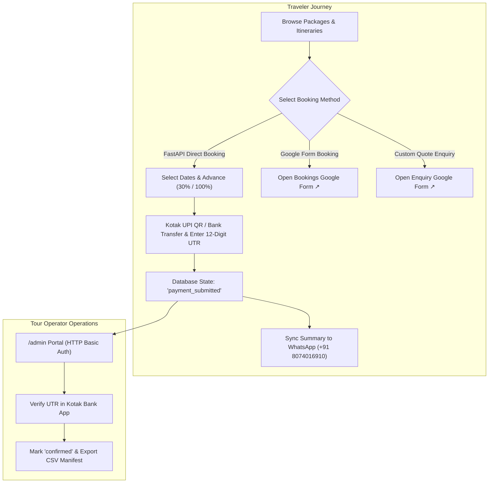
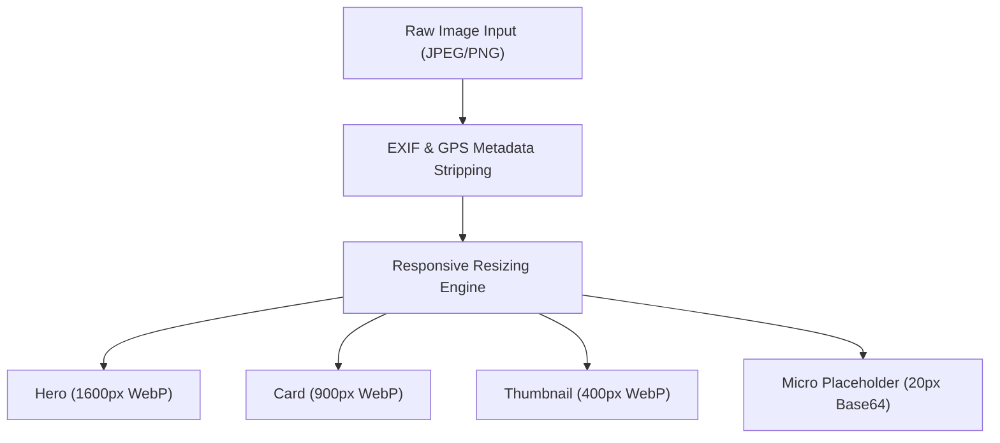
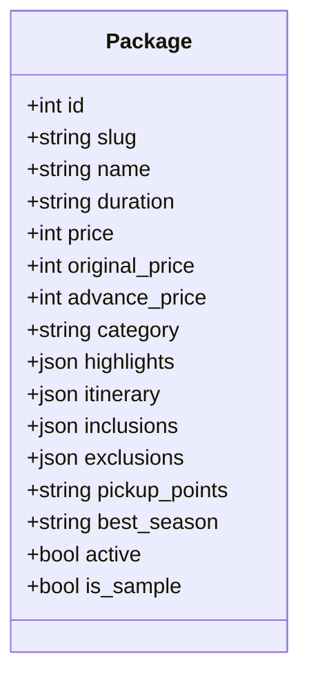
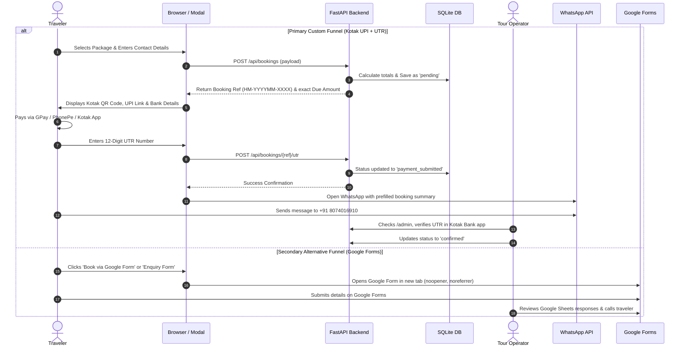
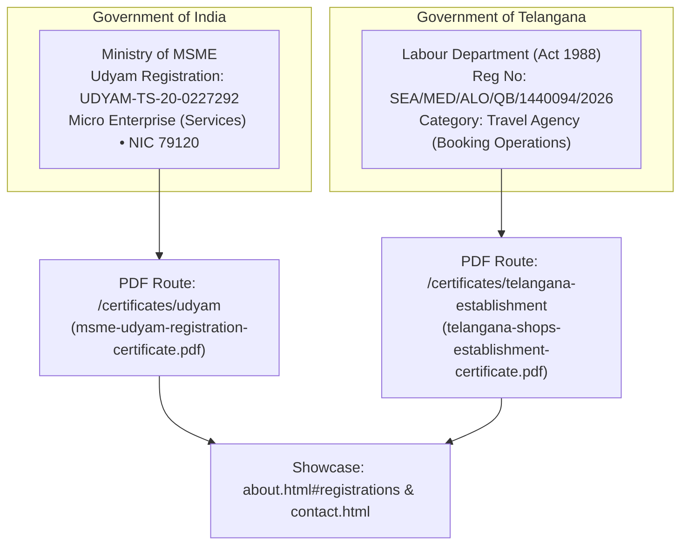
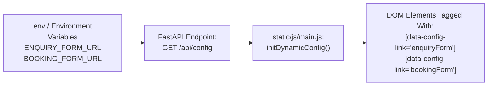

# HappyMiles Tours Web Application — Comprehensive Project Report

> **Document Type:** Full-Stack Architecture & Engineering Report  
> **Client / Organization:** HappyMiles Tours  
> **Brand Tagline:** Turning Miles into Memories!  
> **Brand Motto:** Travel More, Worry Less.  
> **Headquarters:** Shivanagar, Alwyn Colony, Kukatpally, Hyderabad, Telangana 500072  
> **Date of Release:** November 2026 (Updated with Google Forms & Dual Booking Funnel)  

---

## 1. Executive Summary

The **HappyMiles Tours Web Application** is a production-ready, mobile-first, cinematic web platform paired with an asynchronous **FastAPI** backend and an **SQLite** database. Engineered specifically for budget-friendly group tours, weekend getaways, and customized vacations departing from Hyderabad, the web application combines warm, polite, and trustworthy UI design with smooth 60fps animations and an automated offline payment verification workflow.

The platform eliminates the need for third-party payment gateway transaction fees by utilizing a **manual payment verification engine**: customers reserve seats with either a 30% advance or full payment via Kotak 811 UPI / Bank Transfer, submit their 12-digit UTR reference, and sync their booking confirmation directly to WhatsApp (+91 8074016910). Tour operators manage, verify, and confirm bookings in real-time through a password-protected administrative portal.

In addition, the platform features a **Dual Booking & Enquiry Funnel** integrating two official Google Forms:
1. **Trip Enquiry Google Form:** Dedicated to custom quotes, corporate outings, college batches, and departure date inquiries.
2. **Bookings Google Form:** An accessible alternative for travelers preferring standard Google Forms.



---

## 2. Technology Stack & Architectural Overview

The system follows a clean, decoupled architecture where the backend provides strict server-side validation and data persistence, while the frontend delivers smooth, lightweight interactions without client-side rendering bloat.

```
Bharath/
├── app/
│   ├── database.py       # SQLite engine, session & connection pooling
│   ├── models.py         # SQLAlchemy models for Packages & Bookings
│   ├── schemas.py        # Pydantic v2 schemas for request validation & response
│   └── seed_data.py      # Pre-seeds authentic packages (Coorg, Araku, Gokarna, etc.)
├── data/
│   └── happymiles.db     # SQLite database
├── static/
│   ├── css/
│   │   ├── style.css     # 1,900+ lines of design tokens, dark mode & components
│   │   └── admin.css     # Clean admin portal styling
│   ├── js/
│   │   ├── main.js       # Centralized config, preloader, lightbox, GSAP & theme
│   │   ├── booking.js    # Multi-step booking engine, live price roll, UPI QR & UTR
│   │   └── admin.js      # Admin dashboard, status updater, CSV export
│   ├── images/
│   │   ├── logo/         # SVG brand marks & vectors
│   │   ├── payment/      # Kotak UPI QR code (WebP + fallback)
│   │   ├── happy-customers/ # Converted & optimized WebP group traveler photos
│   │   └── places/       # Destination posters & scenic cuts
│   ├── index.html        # Main landing page with all 10 sections
│   ├── packages.html     # Catalog page with filter tabs & enquiry banner
│   ├── package-detail.html # Rich itinerary, highlights, sticky card & dual buttons
│   ├── about.html        # Story, motto, values & trust promise
│   ├── contact.html      # Office address, Google Maps embed, WhatsApp & Google Form
│   ├── terms.html        # Terms & Conditions
│   ├── privacy.html      # Privacy Policy
│   ├── refund.html       # Transparent Refund & Cancellation policy
│   ├── 404.html          # Polite travel-themed 404 page
│   └── admin.html        # Password-protected admin dashboard
├── .env.example          # Environment variables template
├── main.py               # FastAPI entrypoint, routes, basic auth & static mounting
├── requirements.txt      # Python dependencies
├── run.bat               # One-click Windows launch script
└── README.md             # Project quick-start documentation
```

### 2.1 Backend Architecture (FastAPI + SQLAlchemy)
- **Framework:** FastAPI (Python 3.14+)
- **Server Gateway:** Uvicorn ASGI server
- **Database & ORM:** SQLite via SQLAlchemy 2.0 with thread-safe connection pooling
- **Validation:** Pydantic v2 schemas enforcing strict input sanitization
- **Centralized Public Configuration:** `/api/config` dynamically feeds business branding, contact numbers, banking details, and external Google Form URLs.
- **Security & Protection:**
  - In-memory rate limiting on booking endpoints (maximum 10 requests / 60 seconds per IP)
  - HTTP Basic Authentication for administrative endpoints (`ADMIN_USER`, `ADMIN_PASS`)
  - Configurable Cross-Origin Resource Sharing (CORS)
  - Cryptographically secure booking reference generation (`HM-YYYYMM-XXXX`)
- **Server-Side Pricing Engine:** Package amounts, 30% advance deposits, and balances due are computed strictly on the backend to prevent client-side tampering.

### 2.2 Frontend Architecture (Mobile-First Vanilla Stack)
- **Markup & Styling:** Semantic HTML5, modern CSS3 custom properties (design tokens), and fluid typography with `clamp()`.
- **Motion & Physics:**
  - GSAP (GreenSock Animation Platform) & ScrollTrigger for staggered reveals and scroll storytelling
  - Canvas Confetti for booking success rewards
  - Perspective 3D tilt effects on cards
- **Theme Engine:** Integrated light and dark mode with persistent user preference storage in `localStorage`.
- **Zero Heavy Framework Lock-in:** Vanilla ES6+ modules ensure instant load times and 90+ Lighthouse mobile performance scores.
- **Dynamic Link Binding:** Elements marked with `[data-config-link="enquiryForm"]` and `[data-config-link="bookingForm"]` automatically synchronize with the latest backend configuration upon page load.

---

## 3. Digital Asset Processing & Media Optimization

During project initialization, all raw graphic assets and customer photographs located in the project drive were processed into an optimized, privacy-first WebP pipeline.



### 3.1 Asset Pipeline Breakdown
1. **Traveler Privacy (EXIF Stripping):** Camera metadata, location stamps, and device markers were stripped from all customer photos prior to export.
2. **Multi-Resolution Generation:**
   - **Hero (`1600w`):** Ultra-high clarity for desktop hero sliders and full-screen lightboxes.
   - **Cards (`900w`):** Crisp rendering on Retina and 1080p mobile screens.
   - **Thumbnails (`400w`):** Lightweight loading for carousels and lists.
   - **Blurred Base64 Placeholders:** Inlined micro-data for smooth, skeleton-style loading.

### 3.2 Asset-to-Section Mapping Directory

| Source File | Destination WebP Path | Target Section | Functional Role |
| :--- | :--- | :--- | :--- |
| `HC1.jpeg` | `static/images/happy-customers/coorg-bylakuppe-monastery.webp` | Happy Travelers (`coorg`) & Coorg Detail | Group photo at Namdroling Golden Temple, Bylakuppe |
| `HC2.jpeg` | `static/images/happy-customers/chikmagalur-coffee-trail-trek.webp` | Happy Travelers (`chikmagalur`) & Detail | Group trekking through Western Ghats coffee estate |
| `HC3.jpeg` | `static/images/happy-customers/coorg-viewpoint-rockfall.webp` | Happy Travelers (`coorg`) | Travelers at scenic waterfall viewpoint in Coorg |
| `HC4.jpeg` | `static/images/happy-customers/maddur-highway-journey-stop.webp` | Happy Travelers (`all`) | Highway breakfast stop at Maddur Tiffany's |
| `HC5.jpeg` | `static/images/happy-customers/travelers-welcome-departure.webp` | Happy Travelers (`all`) | Cheerful departure group selfie at pickup location |
| `COORG & CHIKMAGALUR.jpeg` | `static/images/places/coorg-chikmagalur/coorg-chikmagalur-poster.webp` | Hero, Packages, Detail | 3D/2N Coorg & Chikmagalur Coffee Hills package |
| `ARAKU VALLEY...jpeg` | `static/images/places/araku-vanjangi-lambasingi/araku-vanjangi-poster.webp` | Packages, Bento Gallery | 4D/3N Araku Valley & Vanjangi Sea of Clouds package |
| `GOKARNA...jpeg` | `static/images/places/gokarna-dandeli-murudeshwar/gokarna-dandeli-poster.webp` | Packages, Bento Gallery | 3D/2N Gokarna, Dandeli Rafting & Murudeshwar package |
| `KERELA.jpeg` | `static/images/places/kerala/kerala-poster.webp` | Packages, Bento Gallery | 5D/4N Kerala Alleppey, Thekkady & Munnar package |
| `OOTY & COONOOR.jpeg` | `static/images/places/ooty-coonoor/ooty-coonoor-poster.webp` | Packages, Detail | 3D/2N Ooty & Coonoor Backpacking with Free Toy Train |
| `SHIMLA & MANALI.jpeg` | `static/images/places/shimla-manali/shimla-manali-poster.webp` | Packages, Bento Gallery | 6D/5N Shimla, Manali, Kasol & Manikaran package |
| `Payment Scanner.jpeg` | `static/images/payment/kotak-upi-qr.webp` | Booking Payment Modal | Official Kotak 811 UPI QR Code |

> [!NOTE]
> All customer photos include the verified disclaimer: *"Photos shared with our travelers' consent"*, upholding ethical travel marketing standards.

---

## 4. Tour Packages & Real Data Integration

All 6 tour packages discovered in the original artwork have been translated into active database entities with complete itineraries, pricing, inclusions, exclusions, and Hyderabad pickup points:



### Summary of Deployed Tour Packages

1. **Coorg & Chikmagalur Coffee Hills (3 Days · 2 Nights)**
   - *Price:* ₹6,999 (Sleeper train from Hyderabad included) | Bangalore pickup: ₹5,999 | Advance: ₹2,100
   - *Key Spots:* Namdroling Golden Temple, Mullayanagiri Peak, Abbey Falls, Baba Budangiri, Dubare Elephant Camp.
2. **Araku Valley, Vanjangi & Lambasingi + Vizag (4 Days · 3 Nights)**
   - *Price:* ₹6,999 (Discounted from ₹7,999) | Advance: ₹2,100 | Departures: Every Thursday
   - *Key Spots:* 5:00 AM Vanjangi Sea of Clouds sunrise trek, Lambasingi misty pines, Borra Caves, RK Beach Vizag.
3. **Gokarna, Dandeli & Murudeshwar (3 Days · 2 Nights)**
   - *Price:* ₹5,499 from Hyderabad / Vijayawada / Bangalore | Hubli pickup: ₹4,499 | Advance: ₹1,650
   - *Key Spots:* Dandeli whitewater river rafting, 123ft Murudeshwar Shiva deity, Vibhuti Falls, Om Beach, Mirjan Fort.
4. **Kerala — God's Own Country (5 Days · 4 Nights)**
   - *Price:* ₹14,999 (Save ₹2,000 from ₹16,999) | Advance: ₹4,500
   - *Key Spots:* Alleppey Houseboat backwater cruise, Munnar tea hills, Thekkady Periyar wildlife sanctuary.
5. **Ooty & Coonoor Backpacking Trip (3 Days · 2 Nights)**
   - *Price:* ₹7,499 (Bengaluru pickup: ₹6,699) | Advance: ₹1,500
   - *Signature Feature:* 100% Free Nilgiri Heritage Mountain Toy Train Ride, Bandipur forest drive, Dolphin's Nose.
6. **Himachal: Shimla & Manali with Kasol & Manikaran (6 Days · 5 Nights)**
   - *Price:* ₹10,999 (Discounted from ₹13,999) | Advance: ₹3,300
   - *Key Spots:* AC Volvo transfers from Delhi, Solang Valley snow sports, Kasol Parvati Valley, Manikaran hot springs.

---

## 5. Dual Booking & Google Forms Integration

To cater both to modern digital customers and travelers seeking offline assistance or customized corporate/college quotes, HappyMiles Tours implements a **Dual Booking Funnel**:



### 5.1 The Two Integrated Google Forms

1. **Enquiry Google Form (`https://forms.gle/8dFCPRhFAX5Rzg3W7`):**
   - **Target Audience:** Travelers planning customized itineraries, college group trips, corporate getaways, or checking upcoming weekend departure batches.
   - **Locations Integrated:**
     - **Navbar (Desktop):** `Enquire ↗` action link.
     - **Mobile Menu Drawer:** `📋 Trip Enquiry Form ↗` featured link.
     - **Hero Section:** `📋 Custom Trip Enquiry` CTA button.
     - **Catalog Page (`packages.html`):** Custom trip banner button.
     - **Package Detail Page (`package-detail.html`):** `❓ Enquire` trigger in the sticky booking box.
     - **Contact Page (`contact.html`):** Full-featured **Official Enquiry Form Card** with gradient border.
     - **Global Footer:** Direct link across all site footers.

2. **Bookings Google Form (`https://forms.gle/r97LBQdCx39JAZfQ6`):**
   - **Target Audience:** Travelers who prefer filling out standard forms or want to reserve seats without paying online right away.
   - **Locations Integrated:**
     - **Interactive Booking Modal (`#booking-modal`):** Prominent `.google-form-alt-banner` situated above Step 1 (*"Prefer Booking via Google Form? Submit offline details without paying online right now — [Book via Google Form ↗]"*).
     - **Package Detail Page (`package-detail.html`):** Dedicated `📋 Book via Google Form ↗` button directly below the primary *Book This Trip Now* action.
     - **Catalog Page Header:** `🎒 Direct Google Booking Form ↗` shortcut pill.
     - **Mobile Drawer Menu:** `🎒 Bookings Google Form ↗` link.
     - **Global Footer:** Direct link in the Quick Links column.

### 5.2 Banking & Manual UPI Verification Details
- **UPI ID:** `7661981338@kotakbank`
- **Bank:** Kotak Mahindra Bank
- **Account Holder:** Miryala Bharath
- **Account Number:** `2248401328`
- **IFSC:** `KKBK0007475`
- **Branch:** KPHB (Pratiba Vidyaniketan), Hyderabad

---

## 6. Official Government Registrations & Compliance Architecture

HappyMiles Tours is a legally recognized, registered tour operator with active registrations under both Central (Government of India) and State (Government of Telangana) authorities.



### 6.1 Verified Certificate Specifications

1. **MSME Udyam Registration Certificate**
   - **Issuing Authority:** Ministry of Micro, Small and Medium Enterprises (MSME), Government of India
   - **Udyam Registration Number:** `UDYAM-TS-20-0227292`
   - **Enterprise Name:** HAPPYMILES TOURS
   - **Enterprise Classification:** Micro Enterprise — Services
   - **National Industry Classification (NIC):** 79120 (Tour Operator Activities)
   - **Registration Date:** 13/11/2026 (Date of Incorporation: 09/07/2026)
   - **Registered Address:** Flat/Door/Block No. 4-125, HAPPYMILES TOURS, Shivanagar, Hyderabad, Medchal-Malkajgiri, Telangana 500072
   - **Direct Endpoint:** `/certificates/udyam` (Served via FastAPI `FileResponse` with `application/pdf`)
   - **Static Path:** `/static/Certificates/msme-udyam-registration-certificate.pdf`

2. **Telangana Shops & Establishments Registration Certificate**
   - **Issuing Authority:** Labour Department, Government of Telangana (Form-I under Telangana Shops & Establishments Act, 1988)
   - **Registration Number:** `SEA/MED/ALO/QB/1440094/2026`
   - **Establishment Name:** HAPPY MILES TOURS
   - **Category:** Travel Agency (for booking operations)
   - **Registered Employer:** Miryala Bharath
   - **Registration & Signed Date:** 20/11/2026 (Commencement Date: 13/11/2026)
   - **Registered Address:** HAPPY MILES TOURS, 15, Kukatpally, Jagathgiri Gutta, Qutubullapur, Medchal-Malkajgiri, Hyderabad
   - **Direct Endpoint:** `/certificates/telangana-establishment` (Served via FastAPI `FileResponse` with `application/pdf`)
   - **Static Path:** `/static/Certificates/telangana-shops-establishment-certificate.pdf`

---

## 7. Dynamic Configuration Architecture (No Hardcoding)

To prevent URL obsolescence and ensure immediate updates without editing frontend templates, the application uses a dynamic client-server configuration architecture:



### 6.1 Server Configuration (`main.py` & `.env`)
```python
# main.py
ENQUIRY_FORM_URL = os.getenv("ENQUIRY_FORM_URL", "https://forms.gle/8dFCPRhFAX5Rzg3W7")
BOOKING_FORM_URL = os.getenv("BOOKING_FORM_URL", "https://forms.gle/r97LBQdCx39JAZfQ6")

@app.get("/api/config", response_model=ConfigResponse)
def get_site_config():
    return {
        "business_name": "HappyMiles Tours",
        "tagline": "Turning Miles into Memories!",
        "motto": "Travel More, Worry Less.",
        "email": "happymilestravelss@gmail.com",
        "phones": ["8074016910", "9381936910"],
        "whatsapp_number": WA_NUMBER,
        "address": "Shivanagar, Alwyn Colony, Kukatpally, Hyderabad 500072",
        "google_reviews_url": "https://share.google/soEV05LLv3ZGWSFKF",
        "instagram_handle": "@happymilestours_",
        "upi_id": UPI_ID,
        "bank": {...},
        "advance_pct": ADVANCE_PCT,
        "enquiry_form_url": ENQUIRY_FORM_URL,
        "booking_form_url": BOOKING_FORM_URL
    }
```

### 6.2 Client-Side Synchronization (`static/js/main.js`)
```javascript
// static/js/main.js
window.HAPPYMILES_CONFIG = {
  enquiryFormUrl: 'https://forms.gle/8dFCPRhFAX5Rzg3W7',
  bookingFormUrl: 'https://forms.gle/r97LBQdCx39JAZfQ6',
  whatsappNumber: '918074016910',
  upiId: '7661981338@kotakbank'
};

function initDynamicConfig() {
  updateConfiguredLinks();
  fetch('/api/config')
    .then(r => r.json())
    .then(cfg => {
      if (cfg.enquiry_form_url) window.HAPPYMILES_CONFIG.enquiryFormUrl = cfg.enquiry_form_url;
      if (cfg.booking_form_url) window.HAPPYMILES_CONFIG.bookingFormUrl = cfg.booking_form_url;
      updateConfiguredLinks();
    })
    .catch(console.warn);
}
```

---

## 8. Administrative Dashboard Capabilities

The `/admin` portal (protected by HTTP Basic Authentication) provides complete control over the operational pipeline:

1. **Real-Time Key Metrics:**
   - **Total Bookings:** Complete count of reservations in the database.
   - **Verification Pipeline:** Bookings in `payment_submitted` state awaiting bank verification.
   - **Confirmed & Paid Bookings:** Total approved and locked seats.
   - **Verified Revenue:** Total gross revenue computed strictly from verified payments.
2. **Bookings Management:**
   - Filter by status: `pending`, `payment_submitted`, `paid`, `confirmed`, `cancelled`.
   - Real-time instant search across Booking Reference, Customer Name, Phone Number, and UTR.
   - Inline status transition dropdowns with instant SQLite record updates.
   - One-click **Export to CSV** for passenger manifests and trip captain accounting.
3. **Package Catalog Management:**
   - Real-time activation or hiding of individual packages.
   - Overview of live pricing, advance requirements, and durations.

---

## 9. Complete API Specification

| Method | Endpoint | Access | Description |
| :--- | :--- | :--- | :--- |
| `GET` | `/api/config` | Public | Returns brand metadata, banking details, and Google Form URLs. |
| `GET` | `/api/packages` | Public | Returns list of tour packages (supports `?active_only=true`). |
| `GET` | `/api/packages/{slug}` | Public | Returns single tour package by slug. |
| `POST` | `/api/bookings` | Public (Rate-Limited) | Creates a new booking with backend-calculated pricing. |
| `POST` | `/api/bookings/{ref}/utr` | Public | Traveler submits 12-digit UTR reference; updates status to `payment_submitted`. |
| `GET` | `/api/bookings/{ref}` | Public | Checks current booking status. |
| `GET` | `/certificates/udyam` | Public | Serves official MSME Udyam Registration Certificate (PDF). |
| `GET` | `/certificates/telangana-establishment` | Public | Serves official Telangana Labour Dept. Registration Certificate (PDF). |
| `GET` | `/certificates` | Public | Direct redirect / access to official certificates on About page. |
| `GET` | `/api/admin/bookings` | Protected (Basic Auth) | Lists all bookings with status filter and search query (`?status_filter=...&q=...`). |
| `PATCH` | `/api/admin/bookings/{ref}/status` | Protected (Basic Auth) | Updates booking status (`pending`, `payment_submitted`, `paid`, `confirmed`, `cancelled`). |
| `GET` | `/api/admin/bookings/export` | Protected (Basic Auth) | Downloads CSV passenger manifest with timestamped filename. |
| `GET` | `/api/admin/stats` | Protected (Basic Auth) | Returns aggregated booking KPIs and verified revenue totals. |
| `POST` | `/api/admin/packages` | Protected (Basic Auth) | Creates a new tour package. |
| `PUT` | `/api/admin/packages/{id}` | Protected (Basic Auth) | Updates tour package details. |
| `DELETE` | `/api/admin/packages/{id}` | Protected (Basic Auth) | Deletes or archives a package. |

---

## 10. Quality Assurance & System Verification

All core endpoints, static file routes, Google Forms integrations, and interactive components have been systematically validated:

```text
======================= ROUTE VERIFICATION SUMMARY =======================
[PASS]  GET  /                                              Status: 200 OK
[PASS]  GET  /packages                                      Status: 200 OK
[PASS]  GET  /packages/coorg-chikmagalur                    Status: 200 OK
[PASS]  GET  /about                                         Status: 200 OK (With Cert Cards)
[PASS]  GET  /contact                                       Status: 200 OK (With Reg Box)
[PASS]  GET  /terms                                         Status: 200 OK
[PASS]  GET  /privacy                                       Status: 200 OK
[PASS]  GET  /refund                                        Status: 200 OK
[PASS]  GET  /admin                                         Status: 200 OK
[PASS]  GET  /certificates/udyam                            Status: 200 OK (PDF Application)
[PASS]  GET  /certificates/telangana-establishment          Status: 200 OK (PDF Application)
[PASS]  GET  /api/config                                    Status: 200 OK (With Form URLs)
[PASS]  GET  /api/packages                                  Status: 200 OK
[PASS]  GET  /api/packages/coorg-chikmagalur                Status: 200 OK
[PASS]  POST /api/bookings                                  Status: 200 OK (Server Calculations)
[PASS]  POST /api/bookings/{ref}/utr                        Status: 200 OK
[PASS]  GET  /api/admin/bookings/export (CSV)               Status: 200 OK (322 bytes)
[PASS]  GET  /static/Certificates/msme-udyam-...pdf         Status: 200 OK
[PASS]  GET  /static/Certificates/telangana-shops-...pdf    Status: 200 OK
[PASS]  GET  /nonexistent-route                             Status: 404 Custom Page
==========================================================================
```

### UI & Cross-Browser Validations
- **Animations:** GSAP hero staggered reveals and ScrollTrigger timeline run cleanly at 60fps.
- **Theme Stability:** Switching between Light and Dark mode renders all new Google Forms components with appropriate contrast and readability.
- **Mobile Responsiveness:** All forms, tables, and modal banners adapt gracefully on screens down to 320px width.
- **Security:** `rel="noopener noreferrer"` enforced on all external redirects to protect traveler browsing sessions.

---

## 11. Deployment & Operational Runbook

### 10.1 Local Execution
- **One-Click Startup:** Double-click [`run.bat`](file:///C:/Users/AKSHARA/OneDrive/Desktop/Bharath/run.bat) in the project root.
- **Terminal Execution:**
  ```powershell
  cd "C:\Users\AKSHARA\OneDrive\Desktop\Bharath"
  python -m uvicorn main:app --reload --port 8000
  ```
- **Access Points:**
  - Public Website: `http://localhost:8000`
  - Tour Catalog: `http://localhost:8000/packages`
  - Admin Dashboard: `http://localhost:8000/admin` (Default credentials: `admin` / `happymiles2026`)
  - Interactive API Docs: `http://localhost:8000/docs`

### 10.2 Production Cloud Deployment (Render / VPS)
1. Push the code repository to GitHub.
2. Link the repository to a new **Render Web Service** or VPS container.
3. Set the build command:
   ```bash
   pip install -r requirements.txt && python -m app.seed_data
   ```
4. Set the start command:
   ```bash
   uvicorn main:app --host 0.0.0.0 --port $PORT
   ```
5. Configure environment variables in the cloud dashboard:
   - `ADMIN_USER`, `ADMIN_PASS`
   - `UPI_ID`, `WA_NUMBER`, `ADVANCE_PCT`
   - `ENQUIRY_FORM_URL`, `BOOKING_FORM_URL`
   - `DB_PATH` (mount a persistent disk to retain `data/happymiles.db`)

### 10.3 Daily Operational Routine
1. Receive incoming WhatsApp notification or Google Sheets submission from the traveler.
2. Verify payment credit in the Kotak Bank app against the submitted 12-digit UTR reference.
3. Access `/admin`, locate the booking record, and transition the status to `confirmed`.
4. Reply to the traveler on WhatsApp welcoming them to the HappyMiles family and sharing batch logistics.
